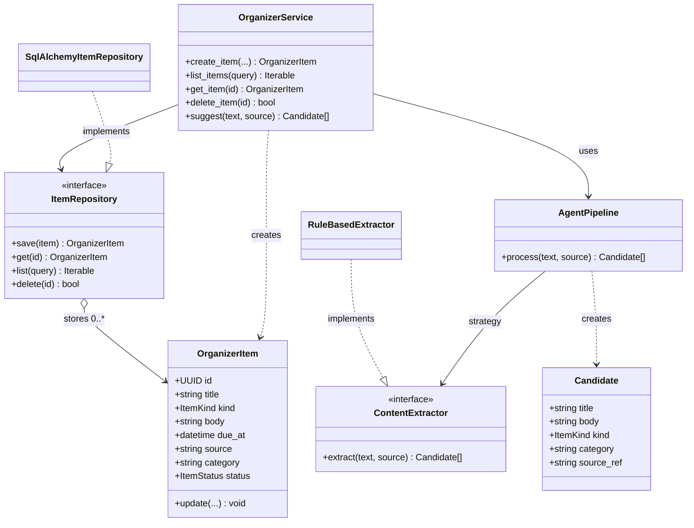
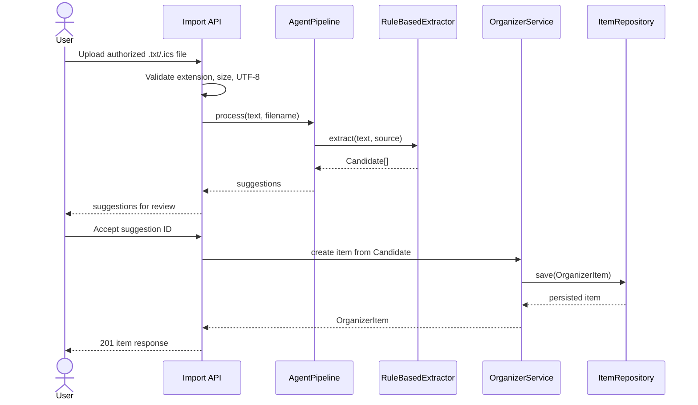
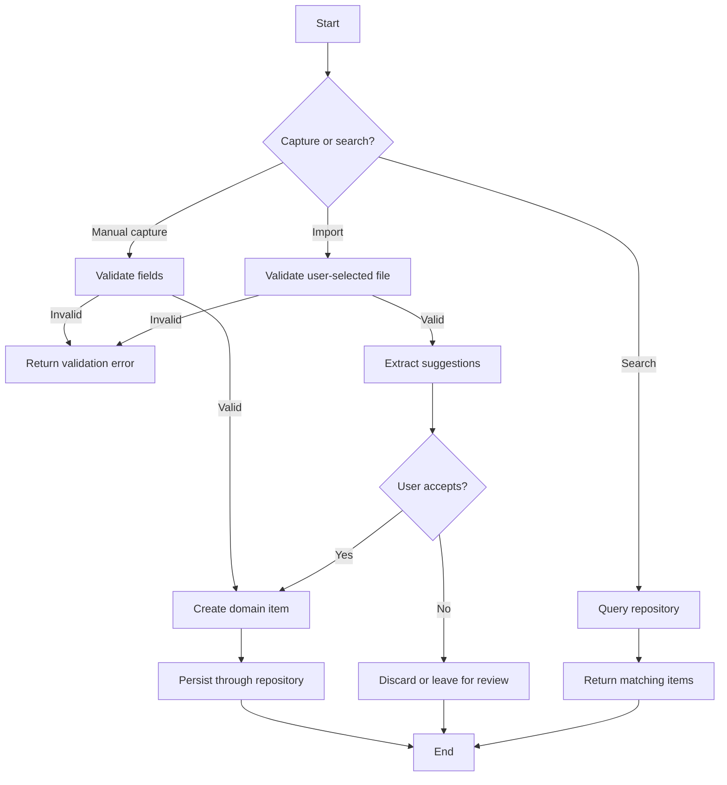

# Diagrams

## Class diagram

Composition is appropriate for service-to-repository/pipeline references; the repository aggregates independently-lived items. Each item has one repository identity; one service can use one repository and one pipeline. The arrow/cardinality notation is conceptual; Python object references are not ownership of item lifetimes.

## Sequence: import and accept

## Activity: capture/search

