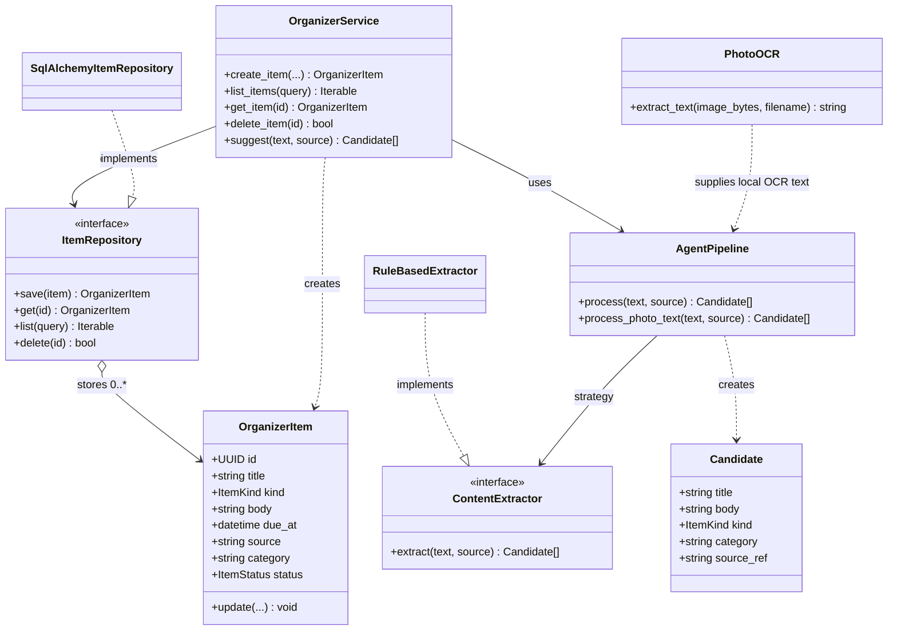
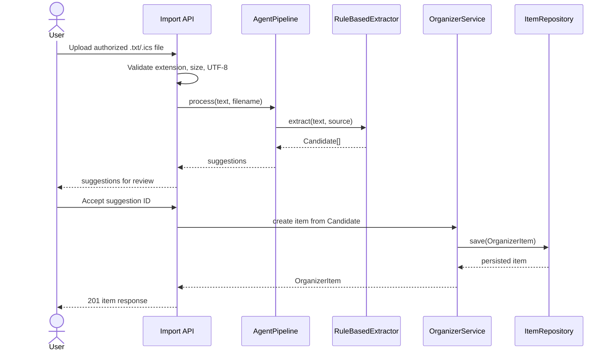
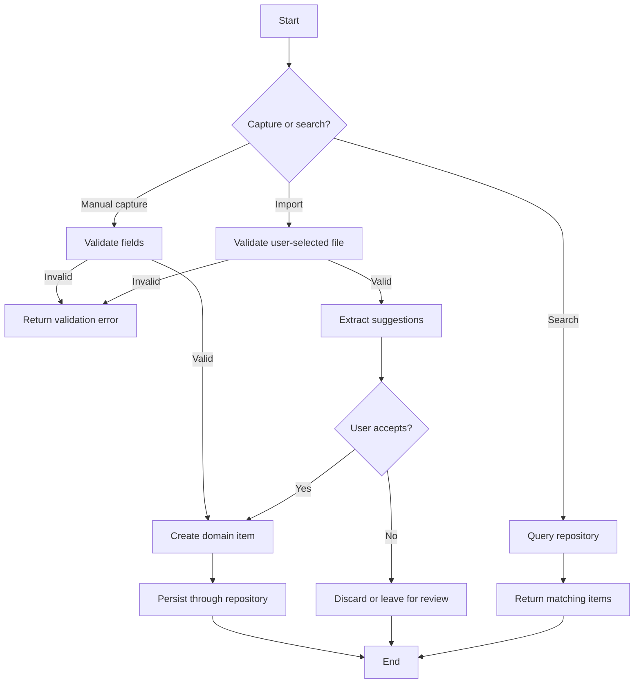
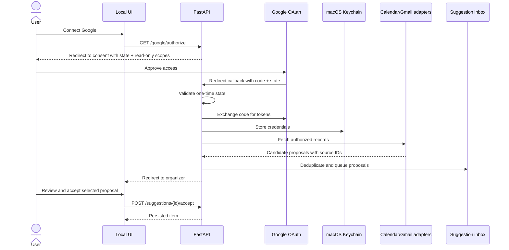
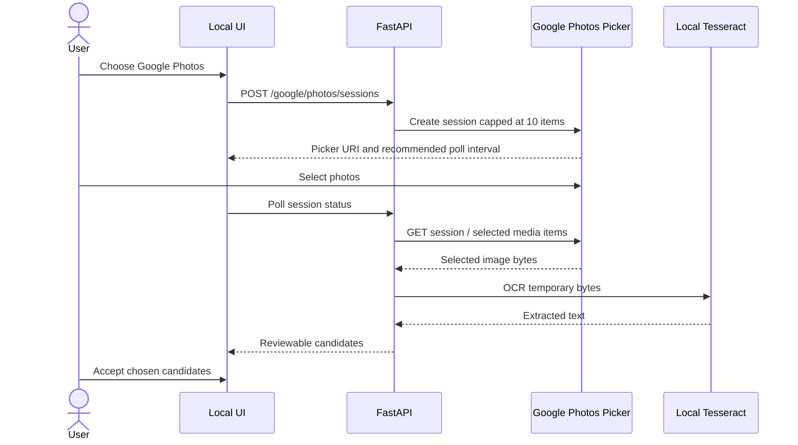
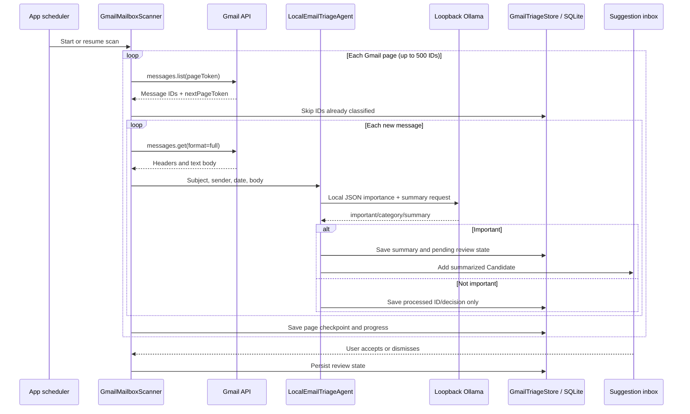

# Diagrams

## Class diagram



Composition is appropriate for service-to-repository/pipeline references; the repository aggregates independently-lived items. Each item has one repository identity; one service can use one repository and one pipeline. The arrow/cardinality notation is conceptual; Python object references are not ownership of item lifetimes.

## Sequence: import and accept



## Activity: capture/search




## Sequence: selected iPhone photo to reviewable note

```mermaid
sequenceDiagram
    actor User
    participant Browser as iOrganizer UI
    participant API as Import API
    participant OCR as Local Tesseract OCR
    participant Pipeline as AgentPipeline
    participant UserReview as Suggestion review
    User->>Browser: Select photo on iPhone and AirDrop to Mac
    User->>Browser: Choose the photo file
    Browser->>API: POST /api/v1/imports (multipart image)
    API->>API: Check extension and 10 MB limit
    API->>OCR: Decode temporary image and recognize text
    OCR-->>API: OCR text; temporary image removed
    API->>Pipeline: process_photo_text(text, filename)
    Pipeline-->>API: Task candidates or one note candidate
    API-->>Browser: Suggestions with photo provenance
    User->>UserReview: Review and accept or dismiss
    UserReview->>API: POST /api/v1/suggestions/{id}/accept
    API-->>Browser: Saved item response
```

## Google Calendar and Gmail sync



## Google Photos selection



## Full Gmail triage


